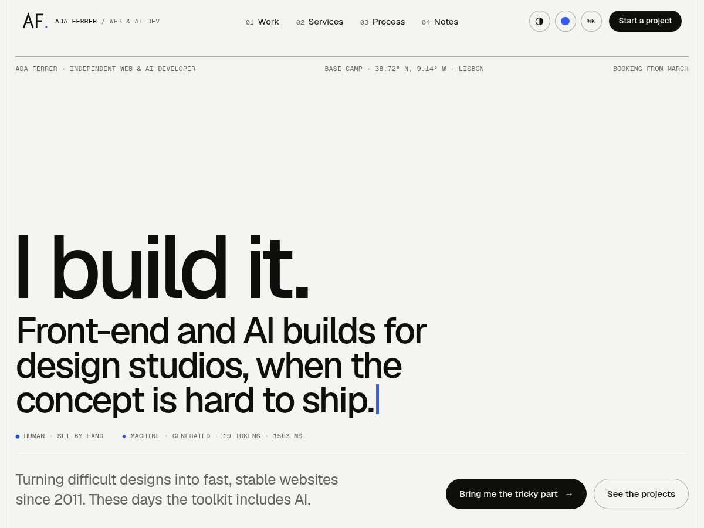

# Contour — free Astro template with a working contact form

A one-page portfolio for a freelance developer or a small studio that builds websites and AI features for agencies. Blueprint look: warm off-white paper, ink type, one cobalt accent, mono labels and a layout grid you can switch on. Motion runs on GSAP with ScrollTrigger and SplitText plus Lenis smooth scrolling, all bundled.



**Live demo:** https://contour.formgong.com · **Template page:** https://formgong.com/en/website-templates/contour/?utm_source=github&utm_medium=template&utm_campaign=contour-astro

[](https://app.netlify.com/start/deploy?repository=https://github.com/formgong-hq/contour-astro)
[](https://vercel.com/new/clone?repository-url=https://github.com/formgong-hq/contour-astro)
[](https://deploy.workers.cloudflare.com/?url=https://github.com/formgong-hq/contour-astro)

## Features

- One-page, responsive, fonts bundled (no Google Fonts requests)
- Contact form that works without a server, powered by [Formgong](https://formgong.com/?utm_source=github&utm_medium=template&utm_campaign=contour-astro&utm_content=features), a free form backend
- Spam protection (honeypot), success/error states from the real server answer
- Privacy page included · MIT licensed

## Quick start

```sh
npm install
npm run dev     # http://localhost:4321
npm run build   # static site in dist/
```

## Contact form via Formgong

The form posts straight to `https://formgong.com/submit`; no backend, no PHP, no serverless function.


1. Create a form at https://formgong.com/new and copy its access key.
2. Open `src/content.json` and replace `fk_your_access_key` (under `form.access_key`) with that key. Every text of the page lives in the same file.
3. The form sends `access_key`, `subject`, `botcheck`, `name`, `email`, `company`, `budget`, `message`. The page shows thanks only when Formgong answers `success: true`.

Submissions arrive by email (and optionally Telegram, Slack or Discord). Formgong has a free plan: [create a free form](https://formgong.com/?utm_source=github&utm_medium=template&utm_campaign=contour-astro&utm_content=form-setup).

## Deploy

Build command: `npm run build` · Output directory: `dist`. Works on Netlify, Vercel, Cloudflare and any static host.

## Files


```
public/
  fonts/
    geist-latin.woff2
    geist-mono-latin.woff2
    OFL-Geist.txt
  img/  (7 files)
  privacy/
    index.html
  site.css
  site.js
src/
  components/  (9 files)
  layouts/
    Base.astro
  pages/
    index.astro
  content.json
.gitignore
astro.config.mjs
LICENSE
package.json
```

## Images

The project photos were generated for this template (FLUX image generation). The projects, clients and people are fictional. Replace them with your own before launch.

## Fonts

Geist, Geist Mono: bundled as WOFF2 files (Latin and Latin Extended), no requests to Google Fonts. SIL Open Font License 1.1, the licence texts are next to the font files.

MIT license.

## Privacy page

The form and the footer link to `/privacy/`, which is `public/privacy/index.html`. It is a neutral sample: put in who runs the site, a contact address and how long you keep messages before launch.

## License

MIT © Formgong. Demo names, texts and photos are fictional sample content. Questions: support@formgong.com
